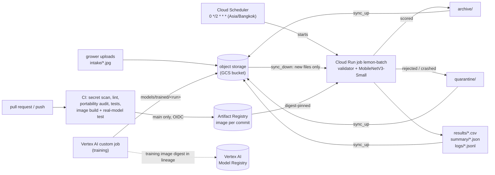

# Lemon Leaf Triage — scheduled batch inference on GCP

Growers upload photos of lemon leaves; every 2 hours a Cloud Scheduler entry starts a Cloud Run job that scores the new photos,
flags leaves that are not healthy for manual inspection, and sets aside photos it should not
trust (blurry, corrupted, not a leaf). Nothing needs to be running between batches.

> Course project (ITCS355). Model accuracy is not the point; the operational system is.

## Who uses it, and what it promises

| | |
|---|---|
| User | An orchard manager who wants a short list of trees to walk to |
| Serving pattern | **Scheduled batch** (not online): leaf photos are not urgent, and batch processing costs nothing while idle |
| Freshness | A photo is scored at the next scheduled run: up to approximately 2 hours plus the job's own run time (about 10 s start-up and 11 s of scoring for 4 photos in our tests). Measured cadence, and the before/after comparison with GitHub's cron, are in "Schedule cadence" |
| Output | One CSV row per photo (`class`, `confidence`, `needs_inspection`, `status`) and one summary JSON per batch |

## Reproduce the model

```bash
make reproduce
```

Expected test_accuracy: 0.951 ± 0.020

This one command needs Docker and internet access, but **no cloud account or credentials**. It builds the
training image, rebuilds the dataset from the pinned Hugging Face revision inside the container
(about 360 MB download), trains with the fixed seed, then runs `make verify`, which checks two things:
the processed-data fingerprint equals `data/dataset_lineage.json`, and the test accuracy is within the
claim above. Results are written to `reports/reproduce/` and never touch the committed model.

**Runtime.** About 6 minutes on a MacBook Air (Apple Silicon, running the `linux/amd64` image under
emulation) with the image already built: about 3 minutes to download the dataset and about 2 minutes to train
5 epochs. The very first run also builds the image, which adds the time to download the pinned dependencies.

**What the tolerance covers.** Same code, data, seed and PyTorch version (2.6.0, pinned by hash). On the same
CPU architecture the result is identical: the Vertex AI job (x86-64) and a MacBook running the amd64 image gave
exactly 0.9510. Training directly on an arm64 laptop, outside Docker, gave 0.9608 (2 of the 204 test images
gave a different result), which we attribute to CPU floating-point differences. ±0.020 is about 4 images, so a 
different x86-64 CPU should also pass; we have not tried one. It does **not** cover a different PyTorch version, 
which gave 0.9412 on the same data, so the version is locked in `requirements-train.lock`. We did not widen the
tolerance to hide non-determinism. The image is built for amd64 on purpose; on Apple Silicon you will see a
platform warning and the run is slower because it is emulated.

## Architecture



Three layers, same contract as the course portability reference:

1. `src/` — model, validator, batch logic. No provider names, no bucket names.
2. `cloud.env` (gitignored; `cloud.env.ci` carries the non-secret values CI needs) — configuration.
3. `cloudlayer/` — the only code that talks to GCP (`GcpAdapter`). `make portability-audit` enforces it.

The scoring code (`src/`) only sees local folders and imports no cloud SDK. Around it,
`scripts/cloud_batch.py` runs one cycle inside the Cloud Run job: `sync_down` (pull new photos) →
score → `sync_up` (push results), moving files through the adapter with the credentials of the job's own
service account (`lemon-batch`, no key files). The image therefore includes the Google Cloud Storage
client (hash-locked in `requirements-cloud.lock`); the portability rule is that only `cloudlayer/` may use it.

### Behaviour worth knowing
- **New files only.** A photo is "new" if it is in `intake/` and absent from `archive/` and `quarantine/`. Nothing new means exit immediately, without loading the model.
- **`intake/` is never modified**, so any batch can be replayed (`--reprocess`).
- **One bad file never stops the batch.** Rejected files get a status (`REJECTED_BLURRED`, `REJECTED_OOD_NON_LEAF`, `REJECTED_RESOLUTION`, `REJECTED_CORRUPTED`); anything unexpected becomes `ERROR_UNEXPECTED`. Every file ends up in `archive/` or `quarantine/`.
- **Every log line is JSON and carries the `batch_id`.**
- **Schedule cadence (changed, with evidence).** The batch first ran from a GitHub Actions cron
  (`*/30 * * * *`). GitHub runs schedules on a best-effort basis, and in our deployment it missed the
  30-minute promise badly. We replaced it with **Cloud Scheduler → Cloud Run job**
  (`infra/setup_cloudrun.sh`, `make deploy-batch`). The job has a 600 s timeout and no retries, so a failed run
  is visible instead of silently repeated.

  **Note on the Cloud Scheduler name:** The scheduler job is still named `lemon-batch-every-30min` for backward compatibility. Despite the name, it is configured to run every two hours (`0 */2 * * *`) in the `Asia/Bangkok` time zone. The job name is only an identifier and does not determine the execution frequency.

  | | GitHub Actions cron (before) | Cloud Scheduler → Cloud Run job (after) |
  |---|---|---|
  | Configured during recorded test | every 30 min | every 30 min during the recorded test; now every 2 hours |
  | Observed gaps between runs | 4 h 14 m 25 s and 4 h 33 m 54 s | 29 m 56 s to 30 m 04 s, over 34 consecutive gaps |
  | Start vs the scheduled minute | hours late (3 runs in 8 h 48 m, about 17 expected) | 0–7 s after the minute |
  | Worst-case wait for a new photo | more than 4 h 30 m | 30 min + job run time during recorded test; now up to 2 hours + job run time |

  "After" refers to the historical 35 consecutive scheduler executions, from 13:30:01 UTC on 8 Oct to 06:30:05 UTC on 9 Oct. The current schedule is every 2 hours in Asia/Bangkok.
  (17 hours, no run missing; `gcloud run jobs executions list --job lemon-batch` lists them). The GitHub
  workflow is now manual only (`workflow_dispatch`), for replays and the failure demo. A run that finds no
  new photos writes no summary and does not load the model.

## Quick start (clean clone)

Prerequisites: Python 3.11, Docker, git. Cloud steps additionally need the `gcloud` CLI.

```bash
git clone https://github.com/meadowind/ML-Project.git && cd ML-Project
python -m venv .venv && source .venv/bin/activate
make setup          # pinned dependencies
make lint test portability-audit
make image          # builds lemon-batch:<git sha>
```

`make test` should end with `94 passed, 1 xfailed`. The one `xfailed` is intentional: it is the brick-wall photo that the
colour guard still lets through (see "The failure we designed for"). It is marked `strict`, so if the guard ever starts
rejecting that photo the test will fail and tell us to update the documentation.

Run the whole pipeline locally, with no cloud account (blobs live in `data/_local_blob/`):

```bash
python scripts/make_fixtures.py
CLOUD_PROVIDER=local make demo-upload FILES="tests/fixtures/good_leaf.jpg tests/fixtures/corrupt.jpg"
CLOUD_PROVIDER=local make run-batch
```

Local mode is for development. A real deployment uses the GCP steps below.

### Data and training
```bash
make data     # downloads the pinned dataset revision (~360 MB), builds stratified splits
make train    # writes to reports/repro/lemon_classifier — never overwrites the committed model
```
Dataset: Project-AgML *Lemon Leaf Disease Classification* (Hugging Face), CC BY 4.0, revision
pinned in `data/dataset_lineage.json` together with a hash of the processed folder.
Each training run is tracked in MLflow (`sqlite:///mlflow.db`): parameters, metrics, dataset
revision and hash, git commit; the model files are logged as artifacts (stored in the bucket
when a cloud provider is configured) and registered as a new MLflow model version with alias
`candidate`. The run id is stored in the model manifest. Open the UI with
`mlflow ui --backend-store-uri sqlite:///mlflow.db`.
Training results depend on the PyTorch version (see the model card, "Reproducibility").

**Training on cloud compute (Vertex AI custom job).** The model that serves was trained in the cloud:
```bash
make train-cloud                              # builds Dockerfile.train, pushes it, submits a Vertex AI custom job, waits
make fetch-trained RUN=<run id>               # downloads, verifies and compares with the committed model
make fetch-trained RUN=<run id> ARGS=--adopt  # copies it to models/registry/ (then open a pull request)
```
The job (CPU, `n1-standard-8`) rebuilds the dataset from the pinned Hugging Face revision and refuses to
train unless its processed-data hash equals the one in `data/dataset_lineage.json`. It writes
`model.torchscript.pt`, `weights.pt` and `model_manifest.json` to `models/trained/<run id>/` in the bucket.
The manifest records the training environment, job id, run id and the **digest of the training image**, and
registration copies them into the model's lineage next to the serving image digest. Current model: run
`train-20261008t140852z`, torch 2.6.0+cpu, test accuracy 95.1% (the model card compares it with the
earlier local run).
The model that serves is committed at `models/registry/lemon_classifier_v2/`
(`model.torchscript.pt` + `model_manifest.json`).

## Deploy it on your own GCP account

```bash
export BILLING_ACCOUNT=XXXXXX-XXXXXX-XXXXXX   # gcloud billing accounts list
export PROJECT_ID=<your-unique-project-id>
export REGION=asia-southeast1
bash infra/setup_gcp.sh          # project, bucket, registry, service account, budget alert
# copy cloud.env.example to cloud.env and paste the values the script prints
make cloud-check                 # all checks must pass
gcloud auth application-default login
make image && make image-push
bash infra/setup_oidc.sh         # lets GitHub Actions in WITHOUT any stored key
```
Then put the same non-secret values in `cloud.env.ci` and update the project number / service
account emails at the top of `.github/workflows/*.yml` (`setup_oidc.sh` prints them).
Resources are labelled `course=itcs355,student=<project>,lab=capstone`.

If `setup_gcp.sh` stops at an `add-iam-policy-binding` step, the Vertex AI service agent has not been created yet: wait a minute and run the script again (it is safe to repeat).

### The scheduled batch (Cloud Run job + Cloud Scheduler)
```bash
make deploy-batch IMAGE_REF=<registry>/lemon-batch@sha256:...   # job, scheduler service account, every-2-hours entry
make demo-upload FILES="a.jpg b.jpg"   # simulate an upload
make run-batch-cloud                   # run the job once now and wait for it
make scheduler-run-now                 # fire the scheduler entry, as the clock would
make scheduler-pause                   # kill switch (make scheduler-resume to restart)
```
The image is pinned by digest. The job runs as `lemon-batch@…`; the scheduler calls the Cloud Run API as
`lemon-scheduler@…`, which only has `run.invoker` on this one job.

Run a batch by hand locally: `make demo-upload FILES="…"` then `make run-batch`.

## Model registry
The production model is registered in **Vertex AI Model Registry** through the same adapter layer
(`GcpAdapter.register_model`), with its lineage as labels and, in full, in the version description:
git commit, processed-data hash, MLflow run id, digest-pinned serving image, training image digest and
Vertex job, seed and metrics.
**How the batch job pins its model:** the Cloud Run job runs a container image that contains exactly
this model (`models/registry/lemon_classifier_v2/`), and the image is pinned by commit tag and digest,
so a batch is replayable against the same model and code. The registry holds the same model with its
lineage, and `make reload-check` proves it can be pulled back by version and used. We chose the image
as the runtime source so that a batch cannot change model between runs without a new deployment.
```bash
make image-push                       # or take the digest from the CI build of main
make register-model IMAGE_REF=<registry>/lemon-batch@sha256:...
make reload-check                     # pulls the model back from the registry by alias/version,
                                      # verifies its sha256, scores 5 held-out images
```
Registration needs the Vertex AI service agent to read the bucket and the Artifact Registry
repository; `infra/setup_gcp.sh` grants both. The registered model carries the capstone labels, so
`make teardown` deletes it with everything else.

## CI/CD
| Workflow | Trigger | What it does |
|---|---|---|
| `ci.yml` → `test` | every PR and push | gitleaks over the **full** history, hash-checked install, ruff, portability audit, pytest |
| `ci.yml` → `build` | after `test` | builds the image, then runs the **real model** on a deliberately bad batch (corrupt, blurred, non-leaf, good) and asserts exactly 1 scored and 3 quarantined; a second run must be skipped |
| `ci.yml` → publish step | push to `main` only | pushes the image tagged with the commit, using short-lived OIDC credentials |
| `ci.yml` → training image | every PR and push | builds `Dockerfile.train` and smoke-tests its imports, so the cloud training job cannot rot |
| `batch.yml` | manual only | replay or failure-demo batch run from GitHub (the schedule lives in Cloud Scheduler) |

Pull-request runs have no cloud access. OIDC is restricted to this repository's `main` branch.
Kill switch: `make scheduler-pause` (pauses the Cloud Scheduler entry; needs the GCP project, not GitHub admin).
Manual run options: replay everything, or turn the non-leaf guard off (see below).
**CI blocks a bad commit.** To show the tests can actually fail, a deliberately broken commit (blur
cutoff set to 0, so blurry photos would be scored) was pushed in a pull request that was never
merged: 6b92682. Two tests fail (`test_status_per_fixture[blurred_leaf.jpg-REJECTED_BLURRED]` and
`test_bad_batch_never_crashes_and_good_files_still_scored`), and the `build` and publish steps do not
run, so nothing broken reaches the registry.

## Monitoring and alerting

The scheduled production batch is monitored with **Cloud Logging** and **Cloud Monitoring**. The
`lemon-batch` Cloud Run Job is started by Cloud Scheduler every 2 hours.

### Dashboard

The monitoring dashboard is:

* `lemon-batch-monitoring`

It contains four widgets:

1. **Rejected Rate** — rejected file rate for completed batches.
2. **Low Confidence Rate** — low-confidence rate among scored files.
3. **Batch Duration** — duration of completed batch processing.
4. **Successful Batch Executions** — successful `lemon-batch` Cloud Run executions.

### Log-based metrics

The following Cloud Logging metrics are created from `batch_finished` events:

| Metric                            | Meaning                                  |
| --------------------------------- | ---------------------------------------- |
| `lemon-batch-rejected-rate`       | Rejected file rate per completed batch   |
| `lemon-batch-low-confidence-rate` | Low-confidence rate per completed batch  |
| `lemon-batch-duration-seconds`    | Duration of a completed batch in seconds |

The source filter is the `lemon-batch` Cloud Run Job and the `batch_finished` event.

The rejected-rate and low-confidence-rate metrics are Distribution metrics. Their alert policies
use `ALIGN_PERCENTILE_50` to convert each batch's distribution value to a scalar before applying
the threshold.

### Alert policies

Three alert policies are configured:

| Alert policy                            | Trigger                                | Purpose                                             |
| --------------------------------------- | -------------------------------------- | --------------------------------------------------- |
| `lemon-batch-rejected-rate-alert`       | Rejected rate >= 10%                   | Detect an abnormal number of rejected files         |
| `lemon-batch-low-confidence-rate-alert` | Low-confidence rate >= 30%             | Detect batches with unusually uncertain predictions |
| `lemon-batch-missed-run-alert`          | No successful execution for 4 hours | Detect missed or failed scheduled executions        |

The rate alerts use `COMPARISON_GT` because the current Cloud Monitoring configuration does not
support `COMPARISON_GE` for these conditions. The thresholds are therefore configured as `0.099999`
and `0.299999` to capture the intended 10% and 30% boundaries.

The missed-run alert uses the Cloud Run metric:

```text
run.googleapis.com/job/completed_execution_count
```

filtered to:

```text
metric.labels.result="succeeded"
```

and triggers when no successful execution is observed for 4 hours.

A `batch_skipped` event caused by an empty intake directory is still a successful Cloud Run
execution. Therefore, an empty batch does not trigger the missed-run alert.

### Batch events used for monitoring

Important Cloud Logging events include:

* `batch_started`
* `model_loaded`
* `file_scored`
* `file_rejected`
* `file_error`
* `batch_finished`
* `batch_skipped`

The `batch_finished` event contains the main operational metrics:

* `batch_id`
* `files_total`
* `files_scored`
* `files_rejected`
* `rejected_rate`
* `low_confidence_count`
* `low_confidence_rate`
* `needs_inspection_count`
* `duration_seconds`

For detailed investigation, the complete batch summary remains available in:

```text
gs://lemon-mlops-project-data/lemon/summary/
```

The summary JSON also contains `confidence_histogram`, `rejected_samples`, and `by_status`, which
are not included in the `batch_finished` log event.

### Useful monitoring commands

View completed batch events:

```bash
gcloud logging read \
  'resource.type="cloud_run_job" AND resource.labels.job_name="lemon-batch" AND jsonPayload.event="batch_finished"' \
  --project=lemon-mlops-project \
  --limit=20
```

View skipped executions:

```bash
gcloud logging read \
  'resource.type="cloud_run_job" AND resource.labels.job_name="lemon-batch" AND jsonPayload.event="batch_skipped"' \
  --project=lemon-mlops-project \
  --limit=20
```

List alert policies:

```bash
gcloud monitoring policies list \
  --project=lemon-mlops-project
```

### How we know when model performance drops

Production photos arrive without labels, so **accuracy cannot be measured in production**; the held-out test result
(0.951) is the only accuracy figure, and it describes the model on its test set, not on later traffic. What we watch
instead are signals that move when quality is likely to be dropping, in four layers:

| Layer | Where | What it catches |
| --- | --- | --- |
| 1. Input guards | Every photo, before the model | Corrupted, too-small, blurred and non-leaf photos are rejected and quarantined instead of being scored |
| 2. Per-photo flag | Every scored photo | `needs_inspection` is true when the prediction is not Healthy or the confidence is below 0.60 |
| 3. Alerts | Every batch, by email | Rejected rate >= 10%, low-confidence rate >= 30%, and no successful run (see "Alert policies") |
| 4. Drift diagnosis | On demand, `make diagnose` | Compares recent batches with earlier ones and says whether the photos or the model's confidence changed (next section) |

A rising rejected rate points at the photos (camera, upload, wrong subject). A rising low-confidence rate or a falling
confidence on unchanged photos points at the model. A shift in the photos' blur or foliage distribution, or in the mix
of predicted diseases, is drift that the alerts alone do not show: it can happen while every rate stays under its
threshold. These are proxies and leads, not proof. Confirming a real accuracy drop needs labels: a person would label a
sample of the `needs_inspection` photos and compare with the predictions. We have not built that loop.

### Diagnosing a drop in quality

The alerts say *that* a rate moved. `make diagnose` asks *what* moved and whether the cause looks like the
photos or the model. It compares the most recent batches with earlier ones using only the CSVs the batch
already writes (`results/<batch_id>.csv`):

```bash
make diagnose                                        # data/output/results/*.csv (after make run-batch)
make diagnose ARGS="--from-cloud"                    # results/ in the bucket, through the cloud layer
make diagnose ARGS="--recent-batches 2 --json"       # last 2 batches vs everything earlier, as JSON
make diagnose ARGS="--since 2026-10-11T00:00:00Z"    # batches started at or after this UTC time
```

| Signal | What a change suggests |
| --- | --- |
| Rejected rate and its status mix | Mostly `REJECTED_BLURRED`: image quality. `REJECTED_OOD_NON_LEAF`: non-leaf photos. `REJECTED_CORRUPTED` or `REJECTED_RESOLUTION`: upload problem. |
| Low-confidence rate, mean confidence, confidence distribution (PSI) | Confidence falls while the photos look the same: the model is unsure on in-domain data (possible concept drift). |
| Blur score and foliage ratio (Kolmogorov-Smirnov test) | The photos themselves changed (light, camera, background, season): covariate drift. |
| Predicted-class mix (PSI) | The mix of diseases changed; with steady confidence this is a population shift, not necessarily a fault. |

It prints a table of signals, flags the ones that moved, and lists likely causes. Distribution tests only run when
each window has at least 30 scored photos (`--min-samples`); below that it shows the rates and says the tests were
skipped, because small batches move a lot by chance. It cannot measure accuracy: production photos have no labels, so
every cause is a lead for a person to check (open the `needs_inspection` files, label a sample), not a proof.
`--fail-on-drift` makes the exit code 1 when any signal is flagged. On the deployed project the tests ran for the
first time on batch `20261014T190027Z` (38 scored photos); the output and how to read it are in
`docs/evidence/diagnose-cloud/`. That batch was a hand-picked demo set, so the flags show the tool working, not real drift.

To see it flag a real change, `make diagnose-demo SCENARIO=bad_uploads` (also `non_leaf`, `model_uncertainty`,
`covariate_drift`, `stable`) writes **simulated** result files, clearly marked `SIMULATED`, and diagnoses them. Saved
examples are in `docs/evidence/diagnose-simulated/`. They show the logic, not real drift.

### Monitoring validation and evidence

The monitoring setup was validated using a controlled batch of test images and a
scheduled-run interruption test.

#### Controlled batch test

Batch ID: `batch-20261009T090020Z`

| Measurement | Observed result |
| --- | ---: |
| Files processed | 10 |
| Files scored | 6 |
| Files rejected | 4 |
| Rejected rate | 40% |
| Low-confidence rate | 100% |
| Batch duration | 21.09 seconds |

Both rate thresholds were exceeded, and the corresponding Cloud Monitoring
incidents were observed.

#### Missed-run detection and recovery

The missed-run policy generated an incident after no successful execution was
observed for more than 60 minutes while the scheduler was paused for testing.
The scheduler was subsequently re-enabled, and a later Cloud Run execution
completed successfully.

#### Screenshots

Evidence captured during validation:

- Dashboard overview: [11-dashboard-overview.png](docs/evidence/11-dashboard-overview.png)
- Rejected-rate incident: [12-rejected-rate-alert.png](docs/evidence/12-rejected-rate-alert.png)
- Low-confidence incident: [13-low-confidence-alert.png](docs/evidence/13-low-confidence-alert.png)
- Missed-run incident: [14-missed-run-alert-incident.png](docs/evidence/14-missed-run-alert-incident.png)
- Missed-run metric baseline: [15-missed-run-metric-baseline.png](docs/evidence/15-missed-run-metric-baseline.png)
- Scheduler recovery: [16-scheduler-resume-success.png](docs/evidence/16-scheduler-resume-success.png)
- Scheduler recovery (WSL capture): [16b-scheduler-resume-success-wsl.png](docs/evidence/16b-scheduler-resume-success-wsl.png)

These tests verify Cloud Monitoring incident generation, email delivery and scheduler recovery
(the email evidence is indexed in [`docs/evidence/`](docs/evidence/README.md)). Failure handling is in
[`docs/FAILURE_RECOVERY_RUNBOOK.md`](docs/FAILURE_RECOVERY_RUNBOOK.md).

### Monitoring resources

All monitoring resources created for this project use the `lemon-` prefix:

```text
lemon-batch-rejected-rate
lemon-batch-low-confidence-rate
lemon-batch-duration-seconds

lemon-batch-monitoring

lemon-batch-rejected-rate-alert
lemon-batch-low-confidence-rate-alert
lemon-batch-missed-run-alert
```

These resources should be removed during teardown when they are no longer required.


## The failure we designed for

**What we did.** We scored 8 photos that are not lemon leaves (paper, glass, hand, keyboard, brick wall,
and photos of other plants), first with the non-leaf guard off and then on:
```bash
make image
bash infra/failure_demo.sh path/to/folder_of_non_leaf_photos
```
On GitHub the same switch is Actions → batch → Run workflow with `enable_ood_check` unticked.

**What it revealed.** With the guard off, every photo got a disease label, five of them with confidence
≥ 0.90 (a brick wall as Dry_Leaf at 1.00, a keyboard as Anthracnose at 0.93): a softmax classifier always
picks a class, so confidence says nothing about whether the input is a leaf. With the guard on, 2 of 8 were
rejected (`REJECTED_OOD_NON_LEAF`); 6 still passed. The guard is a colour check that accepts foliage green,
necrotic brown and soot black on purpose, so that real Dry_Leaf and Sooty_Mould leaves are not rejected
(0.00% false rejects on the clean data). The cost is that brown or dark non-leaves and other plants can pass.
The photos that slipped through had plant-colour ratios of 0.10–0.99, overlapping or exceeding the range of
real leaves we scored (0.27–0.62), so no single threshold separates them without rejecting real leaves.

**What we changed.** We kept the guard, kept it on by default, and documented the limit instead of tuning
thresholds on 8 photos. The failure is now fed back into the tests:
- `tests/test_batch.py` (`test_non_leaf_scores_confidently_without_guard…`, `test_ood_guard_is_on_by_default…`);
- `tests/test_failure_regression.py`, which uses real photos from this demo (`tests/failure_cases/`): paper
  and glass must be rejected, and the brick wall, which still gets through, is kept as a strict `xfail` so
  the gap is recorded and the test fails loudly the day the guard starts catching it.

The proper fix is a learned "not a leaf" check (an extra class or a one-class detector trained on non-leaf
images); it is not done here.

## Cost per 1,000 predictions
Full report: [`docs/COST_REPORT.md`](docs/COST_REPORT.md). Billing export for 1-11 Oct 2026, taken on 11 Oct at 14:55 Thai
time (list prices; the free-trial credit is not shown): **THB 19.77** in total.

| Item | THB | Share | Note |
|---|---:|---:|---|
| Cloud Run job CPU and memory | 11.71 | 59% | 135 executions (13:30 UTC on 8 Oct to 07:30 UTC on 11 Oct) |
| Artifact Registry network egress | 5.35 | 27% | one-off: image pulls by GitHub runners before the batch moved to Cloud Scheduler; 1.33 GiB in the export of 9 Oct and still 1.33 GiB on 11 Oct |
| Artifact Registry storage | 1.57 | 8% | grows with every image the CI publishes |
| Vertex AI training | 1.13 | 6% | one training run |
| Cloud Storage, Scheduler, other | 0.00 | 0% | |

The job costs about **THB 0.087 per execution** (11.71 / 135), paid whether or not a run finds new photos. At one run every
30 minutes (the original schedule) that is about THB 4.2 a day at list price, before any free tier or credit. This is an average of billed CPU and
memory (about 54 billed seconds per execution), not a measured run time; console durations were 12-40 s.

**Cost per 1,000 predictions.** In the same window (13:30 UTC on 8 Oct to 07:30 UTC on 11 Oct) the logs show 6 batches
with 17 scored photos; the other 129 runs found nothing new. Observed, that is **THB 689 per 1,000 scored predictions** for
Cloud Run (11.71 / 17) and THB 1,163 with every billed item (19.77 / 17). It is high because the volume was tiny and the
scheduled empty runs dominate. The marginal cost of one photo is small: about one second of compute, roughly **THB 1.6 per
1,000 photos** (an estimate from run times, not a billed figure). Spreading the fixed THB 4.2 a day over volume gives about
THB 43 per 1,000 at 100 photos a day, THB 6 at 1,000 a day and THB 2 at 10,000 a day.

## Cost reduction: fewer empty runs

On 12 Oct 2026 (16:28 Thai time) the Cloud Scheduler entry was changed from every 30 minutes to every 2 hours
(`0 */2 * * *`, `Asia/Bangkok`), and `lemon-batch-missed-run-alert` was changed from 60 minutes to 4 hours without a
successful execution. The reason is in the cost table above: 129 of the first 135 executions found no new photos, and a run
costs about THB 0.087 whether or not it finds any. (The scheduler entry keeps its old name; see "Behaviour worth knowing".)

**Runs per day.** Dates are UTC. Counted with
`gcloud run jobs executions list --job lemon-batch --region asia-southeast1 --format='value(metadata.creationTimestamp)' | cut -c1-10 | sort | uniq -c`.

| | 9 Oct | 10 Oct | 11 Oct | 12 Oct | 13 Oct | 14 Oct | 15 Oct |
|---|---:|---:|---:|---:|---:|---:|---:|
| Runs | 47 | 46 | 52 | 26 | 12 | 12 | 12 |
| Schedule | 30 min | 30 min | 30 min, a few manual runs | changed mid-day | 2 h | 2 h | 2 h |

**Effect on cost (estimate).**

| | Every 30 minutes | Every 2 hours |
|---|---:|---:|
| Runs per day | about 48 | 12 |
| Cloud Run cost per run | about THB 0.087 | about THB 0.09-0.11 |
| Cloud Run cost per day | about THB 4.3 | about THB 1.3 |

That is roughly 70% lower. The "every 2 hours" figure is the difference between the billing exports of 13 Oct and 15 Oct
(18:01 Thai time): Cloud Run CPU and memory rose by THB 2.42 over about two days. The cost per run did not change, so the
saving comes entirely from running less often. These are list prices from cumulative month-to-date exports, not daily
reports, and the free tier and credit are not applied; allow about 10% either way. The month-to-date total keeps rising
(THB 19.77, 29.54, then 34.77 across three exports) because it is cumulative, not because the new schedule costs more.

**Trade-offs.** A photo can now wait up to about 2 hours instead of 30 minutes, and a failed run is flagged after about
4 hours instead of 1. If the missed-run alert raises false alarms, raise its window to 5 hours.

**Comparing before and after fairly.** Use full days that ran on one schedule only: 9-10 Oct before, 13-15 Oct after; skip
11 Oct (manual runs) and 12 Oct (changed mid-day). Pull Billing > Reports one day at a time, Cloud Run only (CPU and memory),
and check the report's time zone because its day boundaries may not match Thai time. Compare THB per day, THB per run and
photos scored per day, and leave out any day with demo or test uploads, since runs that find photos take longer.

**Still open.**
- **Artifact Registry storage keeps growing.** It was THB 3.99 on 13 Oct and THB 6.80 on 15 Oct, about THB 1.5 a day, which
  is now more than the Cloud Run cost. The CI publishes an image on every commit to `main` and nothing is deleted. A cleanup
  policy has not been set yet. Before setting one, keep the digest the Cloud Run job uses, the image registered in Vertex AI
  Model Registry, the training image digest in the lineage, and any digest cited in `docs/evidence/`, so replays and
  `make reload-check` keep working; run the policy in dry-run mode first.
- **Options considered and not done.** Upload-triggered runs instead of a timer (needs a lock so overlapping executions
  cannot score the same photo twice, and a new missed-run alert design); right-sizing the job from 2 vCPU / 2 GiB to
  1 vCPU / 1 GiB (not tested); and shortening the roughly 10 s start-up of an empty run (not profiled).

## Shutting everything down
```bash
make scheduler-pause          # stop new runs first
make teardown-plan            # lists what would be deleted (buckets, registries, registered models,
                              # Cloud Run jobs, scheduler entries, training jobs)
make teardown CONFIRM=yes     # deletes them; scheduler entries and Cloud Run jobs go first
```
Before deleting, the configuration of the monitoring resources, Cloud Run job and scheduler and the batch result files were exported to
`docs/evidence/cloud-config/` and `docs/evidence/results-snapshot/`, with steps to recreate them. After teardown,
`make diagnose ARGS="--results-dir docs/evidence/results-snapshot --recent-batches 1"` still works.

Then check the GCP console and billing page — deletion is asynchronous. The OIDC pool and service
accounts cost nothing; deleting the project removes them too (`gcloud projects delete <id>`).
Verified safe with `bash infra/test_teardown.sh` (throwaway resources only).

## What the live deployment showed
**On GitHub's cron (first design).** A batch of 7 real test photos was scored by the scheduled workflow:
7 scored, 0 rejected, 3 flagged *needs inspection*. One *Sooty_Mould* leaf
(`test_Sooty_Mould_0017.jpg`) was predicted *Healthy_Leaf* with confidence 0.98 and was not
flagged: a confident miss that the confidence threshold cannot catch (see the model card).
A second batch (`batch-20261007T192733Z`) was picked up without anyone pressing a button: 6 files,
4 scored and 2 rejected (`glass.jpg`, `paper_sheet.jpg`, both `REJECTED_OOD_NON_LEAF`), so
`rejected_rate` was 0.33, above the 0.10 alert threshold. A manual run just before it failed at the upload
step because GitHub's OIDC token service returned HTTP 500; nothing had been written, and the next run
processed the same photos. The runs came 4–5 hours apart, which is why the schedule moved to Cloud Scheduler.

**On Cloud Scheduler + Cloud Run (current).** Scheduler executions started 0–7 s after the minute, every
30 minutes (the original cadence), 35 times in a row without a gap. A manual execution scored a newly uploaded photo and wrote its summary. After the cloud-trained
model (`v2.1.0`) was deployed, 4 new photos (3 *Sooty_Mould*, 1 *Bacterial_Blight*) were scored in 11 s
and all four were flagged.

**A second failure, found by using the system.** In an earlier batch on the cloud-trained model, a
*Sooty_Mould* leaf was scored *Healthy_Leaf* at confidence 0.54 and `needs_inspection` was `false`, although
the data contract says a leaf is flagged when it is not healthy **or** its confidence is below 0.6. The code
only checked the class, and an existing test had the same mistake written into it (a 0.40-confidence
"Healthy" expected to be unflagged). Fixed in `src/batch/run.py`;
`tests/test_batch.py::test_needs_inspection_follows_the_contract` now covers a sure Healthy, an unsure
Healthy and a diseased leaf.

## Evidence
Screenshots of the live deployment (Vertex training job, model registry lineage, MLflow run, `make reproduce`, registry digests, Cloud Run executions, Cloud Scheduler, a CI failure, a manual batch run) are indexed with captions in [`docs/evidence/`](docs/evidence/README.md).

## Model card and limits
See `docs/MODEL_CARD.md`. In short: single-source dataset; class imbalance; some diseased
leaves (Sooty_Mould recall 0.78; 9 of the 10 test errors are diseased leaves called Healthy) are predicted *Healthy*, sometimes confidently, and would not be
flagged. Data and training details: `README_DATA_TRAINING.md`.

## Repository map
```
src/batch/       batch job              src/model/       validator, inference, training
src/config.py    the only env reader    cloudlayer/      GcpAdapter + base interface
scripts/         sync, fixtures, audit  infra/           GCP setup, OIDC, teardown test, demo
tests/           pytest                 .github/workflows/  CI and manual batch
models/registry/ committed model        data/            lineage + (ignored) working folders
```
